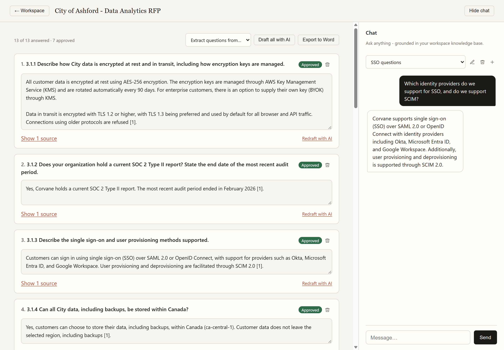
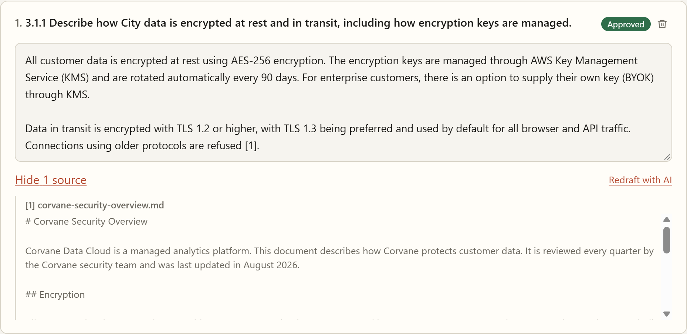
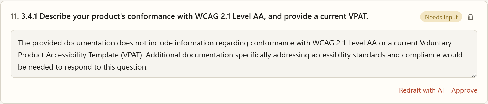
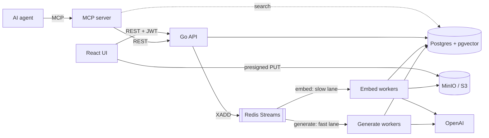
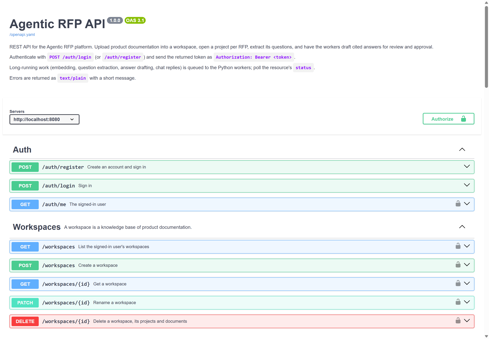

# Agentic RFP

[](https://github.com/MahdiAlani/Agentic_RFP/actions/workflows/ci.yml)
[](LICENSE)

Answers RFPs (requests for proposal) from your own product documentation. Upload
your docs once, drop in an RFP, and get a draft answer to every question. Each
claim cites the passage it came from, and questions your docs don't cover get
flagged for a person instead of a made-up answer.



**Go** REST API · **Python** workers · **PostgreSQL + pgvector** · **Redis Streams** ·
S3-compatible storage · **React** · **MCP** server for AI agents · LLM-graded
**eval harness** · Docker Compose, Kubernetes + KEDA

## Try it

Needs Docker. Set an OpenAI API key for real model-backed answers; without one,
workers use deterministic mock chat and embeddings (for CI and keyless runs).

```bash
cp .env.example .env              # then set OPENAI_API_KEY
docker compose up --build         # API, workers, UI, Postgres, Redis, MinIO
docker compose run --rm seed      # load the demo (in another terminal)
```

Open http://localhost:5173 and sign in as `demo@corvane.example` / `corvane-demo`.
The seed loads documentation for **Corvane**, a fictional analytics vendor, and
answers the **City of Ashford**'s RFP from it. It extracts and drafts 13
questions, and flags three for a person: two the documentation doesn't cover,
and a pricing calculation the model didn't cite. The quality checks refuse to
approve that one until every figure traces back to a source.

| | |
|---|---|
| App | http://localhost:5173 |
| API docs (Swagger UI) | http://localhost:8080/docs |
| MinIO console | http://localhost:9001 (minioadmin / minioadmin) |

## What it does

- **Extracts the questions** from an uploaded RFP (PDF, Word, text), in order.
- **Drafts cited answers.** Each question retrieves the closest passages from
  the workspace knowledge base plus the project's own supporting files. The
  model must cite them inline as `[1]`, `[2]`, and only the passages it
  actually cites are saved, renumbered to match the text.
- **Flags gaps.** An answer the documentation doesn't support comes back with no
  sources and a **Needs input** badge, rather than an invented capability.
- **Review and approval.** Edit any answer; approve it when it's ready. Editing
  an approved answer sends it back for review.
- **Exports to Word**, with each answer's sources and anything still awaiting approval marked.
- **Chat** over the same knowledge base.

<table>
<tr>
<td width="60%"></td>
<td></td>
</tr>
<tr>
<td>Every claim cites the passage it came from.</td>
<td>Uncovered questions are flagged, not invented.</td>
</tr>
</table>

## Architecture



- **Go API** (`backend/`): auth, CRUD, upload orchestration and the job queue.
  It never calls the model, so it stays fast.
- **Uploads skip the API.** The browser PUTs files straight to object storage
  with a presigned URL; the API only confirms the object landed and queues it.
- **Two Redis streams** separate slow bulk work (`embed`: text extraction,
  chunking, embedding, question extraction) from the user-facing path
  (`generate`: answers and chat), so indexing a large document never delays a
  reply. Consumer groups give at-least-once delivery. Jobs left by a crashed
  worker are reclaimed with `XAUTOCLAIM`, and a job that fails 3 times goes to
  a dead-letter stream.
- **Retrieval** is cosine similarity over pgvector (HNSW index), scoped to the
  workspace plus the asking project. RFP documents are excluded: their chunks
  match their own questions almost perfectly and would crowd out the
  documentation that actually answers them.

## Quality: checks and eval

**13 quality checks** (`workers/src/quality.py`) run before an answer can be
signed off through the MCP server. Nine are deterministic: citations present,
every `[n]` marker valid, **every figure in the answer found in a cited
source**, no placeholders, no "as an AI" or "based on the context" phrasing,
plus length, marketing-language and hedging warnings. Four are judged by a
stronger model in a single call: grounded, answers every part of the question,
professional tone, and consistent with the RFP's other answers.

**The eval harness** (`workers/eval/`) replays a fixed set of 21 questions
through the full pipeline and grades every answer:

| Metric | Meaning | Last run |
|---|---|---|
| Fact recall | Expected facts the answer states (LLM-graded) | 100% |
| Supported | Answers whose every claim and figure is backed by a cited source | 100% |
| Abstention | Uncovered questions correctly declined with no sources | 100% |

```bash
docker compose run --rm eval      # exits non-zero below --min-recall / --min-supported / --min-abstention
```

The first run scored 82% supported. It caught the model writing "this is
supported by the context provided" and padding answers with claims its sources
didn't make, plus a judge model too weak to grade reliably. Tightening the
drafting prompt and grading with `gpt-4o` brought every metric to 100%. In CI,
the **Answer eval** workflow runs it on demand (it needs an `OPENAI_API_KEY`
repository secret).

## MCP server: an agent works the RFP

`workers/mcp_server.py` exposes the platform to AI agents over the
[Model Context Protocol](https://modelcontextprotocol.io). It acts as a
configured user through the REST API, so an agent can only see what that user can.

| Tool | |
|---|---|
| `list_projects` | Workspaces and their RFP projects |
| `get_rfp_questions` | Every question with its answer, status and citations |
| `search_documents` | Semantic search over the project's knowledge base |
| `draft_answer` | Draft or redraft an answer and wait for it |
| `edit_answer` | Replace an answer's text |
| `run_quality_checks` | The 13 checks, as blockers and warnings |
| `approve_answer` | Sign off; **refused while any blocker fails** |

The repo's `.mcp.json` points [Claude Code](https://claude.com/claude-code) at
the demo. Open the project with the stack running and ask, for example, *"Work
through the Ashford RFP: draft anything unanswered, check each answer and
approve the ones that pass."* It needs the worker dependencies installed
locally (`pip install -r workers/requirements.txt`).

## API

The REST API is described by an OpenAPI 3.1 spec (`backend/api/openapi.yaml`),
served at `/openapi.yaml` with Swagger UI at
[`/docs`](http://localhost:8080/docs). A test fails if a route is added
without being documented, or documented without existing. `/healthz` (liveness)
and `/readyz` (Postgres, Redis and storage reachable) are there for orchestrators.



## Development

Run the infrastructure in Docker and the services natively, for hot reload:

```powershell
./start.ps1                       # infra containers, migrations, API and UI in new windows
cd workers; pip install -r requirements.txt; python main.py
./stop.ps1
```

Configuration lives in the repo-root `.env` (see `.env.example`). Migrations
in `migrations/` are applied by the `migrate` service
(`docker compose run --rm migrate`). A database created before that service
existed needs a one-time `docker compose run --rm migrate force 9`.

```
backend/     Go API: cmd/api (entrypoint), api (OpenAPI docs), internal/* (one package per resource)
workers/     Python: queue consumers, retrieval, quality checks, MCP server, seed, eval
frontend/    React + Vite UI (served by nginx in Docker)
migrations/  SQL migrations (golang-migrate)
demo/        Fictional knowledge base and RFP used by the seed and the eval
k8s/         Worker Deployments autoscaled by KEDA
tests/e2e/   End-to-end tests against a running stack
```

## Testing

| Suite | Needs | Run |
|---|---|---|
| Go unit tests | nothing | `cd backend && go test ./...` |
| Worker unit tests | nothing (Postgres, Redis and MinIO are faked; missing OpenAI keys use deterministic mocks) | `cd workers && pip install -r requirements-dev.txt && pytest` |
| End-to-end | the running stack | `pytest tests/e2e` |
| + LLM pipeline | the stack and an OpenAI key | `RUN_LLM_E2E=1 pytest tests/e2e` |
| Answer eval | the stack and an OpenAI key | `docker compose run --rm eval` |

CI runs the unit tests, builds the frontend, then brings up the full Docker
stack (building every image) and runs the end-to-end suite against it on every
push and pull request.

## Kubernetes (worker autoscaling)

`k8s/` runs the workers as two Deployments, `WORKER_TYPE=embed` and
`WORKER_TYPE=generate`, each scaled by [KEDA](https://keda.sh) on its Redis
stream lag. CPU-based autoscaling doesn't work here: the workers spend their
time blocked on Redis and OpenAI, so a backed-up pod looks idle.

```bash
docker build -t agentic-rfp-worker:latest workers/
kubectl create secret generic agentic-rfp-env --from-env-file=.env
kubectl apply -f k8s/
```

`embed` scales to zero between uploads; `generate` keeps one replica warm
because chat is user-facing. On shutdown, workers finish in-flight jobs before
exiting.
## License

[MIT](LICENSE)
